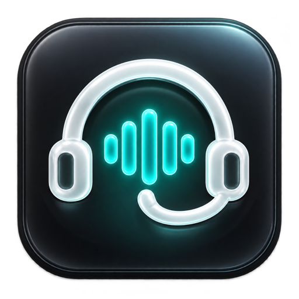
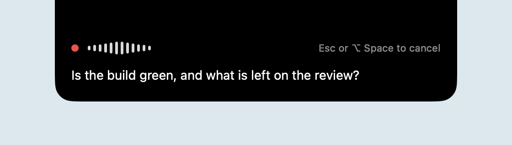
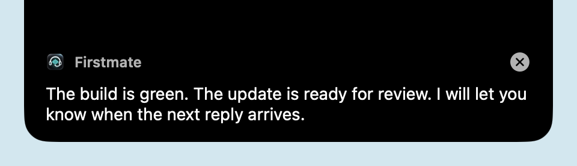
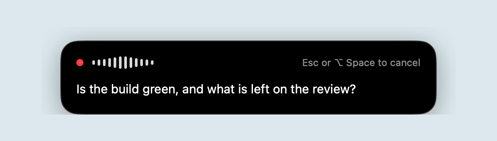
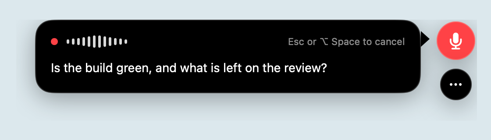
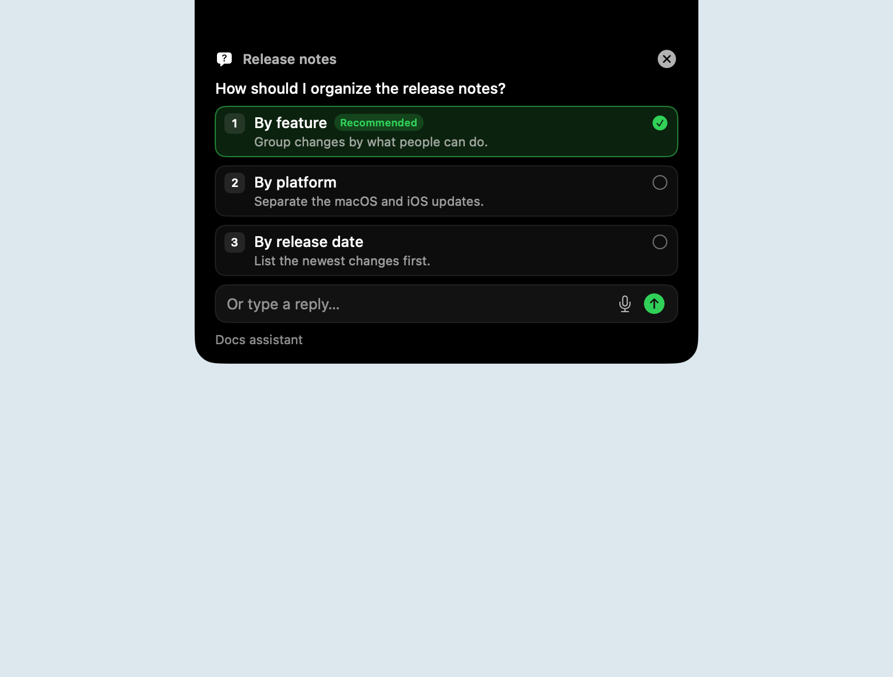
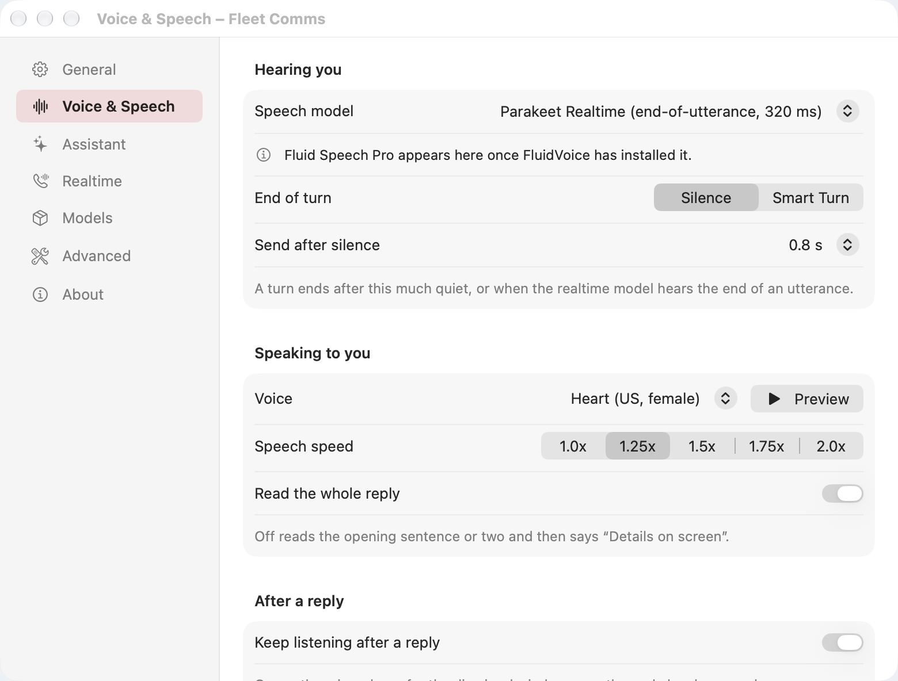

<div align="center">
  
  <h1>Fleet Comms</h1>
  <p><strong>A voice for your agent fleet, right in your Mac’s notch.</strong></p>
  <p>
    <a href="LICENSE"></a>
    
    
    
  </p>
  <p><a href="#getting-started">Get started</a> · <a href="docs/guide.md">User guide</a> · <a href="CONTRIBUTING.md">Contribute</a></p>
</div>

Press **⌥ Space**, speak, and hear the answer. Fleet Comms turns your voice into a conversation with your
local [Firstmate](https://github.com/kunchenguid/firstmate) fleet, with on-device speech recognition and spoken replies. The pill stays out of the way
until you need it.

<p align="center">
  
  <br><em>Talk from the notch.</em>
</p>
<p align="center">
  
  <br><em>Hear the reply. Keep the details on screen.</em>
</p>

Screenshots use neutral demo content from a separate local build. [Capture details](docs/images/README.md).

## Features

- **One hotkey to talk.** Live transcription, voice activity detection, and automatic sending after a pause.
- **Replies you can hear and read.** Speech speed controls, interruption, optional follow-up listening,
  and scrollable reply text.
- **Your fleet within reach.** A fast assistant answers quick questions and passes work to Firstmate;
  delayed replies and unsolicited updates appear when they arrive.
- **Local speech by default.** Parakeet recognition, Silero voice detection, and Kokoro speech through
  FluidAudio. Optional Smart Turn detects when a thought is finished.
- **A place that fits your screen.** Notch, bottom-center card, or side dock, with card themes and text sizes.
- **Optional realtime conversations.** GPT Realtime and Grok Voice, explicitly enabled with your own login.
  These cloud lanes are unofficial integrations; see [privacy](#privacy) before enabling them.
- **Question cards.** An optional Claude Code hook brings multiple-choice, typed, and dictated answers
  into the pill.

## Placements and questions

Choose **Settings → General → Placement** to keep the notch shown above, float a card above the Dock,
or use the buttons at the right screen edge. Click a screenshot to see it at full size.

<table>
  <tr>
    <th>Bottom center</th>
    <th>Side dock</th>
  </tr>
  <tr>
    <td><a href="docs/images/bottom-placement.png"></a></td>
    <td><a href="docs/images/side-placement.png"></a></td>
  </tr>
</table>

The optional [Claude question hook](docs/ask-user-question.md) brings multiple-choice questions into the
same surface. Select an option, type a custom reply, or dictate one, then send your answer.

<p align="center">
  <a href="docs/images/ask-user-question.png"></a>
  <br><em>Answer a question without returning to the terminal.</em>
</p>

## Requirements

- An **Apple Silicon Mac** running **macOS 27 or later**. A notch is optional.
- **Xcode 27** and **XcodeGen** to build from source. The project uses Swift 6.0 with strict concurrency.
- About **310 MB** for the starter speech models, downloaded during setup or on first use.
- A local **firstmate home** containing `bin/fm-inbox.sh` to send work and receive fleet replies.
- Optional: a signed-in **Claude Code CLI** for the fast assistant. Realtime lanes use the Codex or Grok CLI
  login and the corresponding subscription. Fluid Speech Pro is used only when already installed by FluidVoice.

## Getting started

Build and run locally:

```sh
git clone https://github.com/michaelduong/fleet-comms.git
cd fleet-comms
brew install xcodegen
xcodegen generate
xcodebuild -project NotchVoice.xcodeproj -scheme NotchVoice \
  -destination 'platform=macOS,arch=arm64' -derivedDataPath build build
open "build/Build/Products/Debug/Fleet Comms.app"
```

The default signing configuration runs locally without an Apple Developer team. For your own signing team
or a separate settings domain, copy `Config/Local.xcconfig.example` to the ignored `Config/Local.xcconfig`.
The project and Swift module retain the original `NotchVoice` name. See [CONTRIBUTING.md](CONTRIBUTING.md)
for tests, developer switches, signing, and release packaging.

On first launch, allow microphone access, select a firstmate home, and download the starter models.
Each step can be skipped and revisited in Settings. Accessibility permission is not required for the hotkey.
Without a firstmate home, you can explore the UI and use the configured assistant, but cannot send fleet notes.

## Usage

| Action | Control |
| --- | --- |
| Start talking | **⌥ Space**, or click the pill |
| Send your words | Pause; the default silence threshold is 0.8 seconds |
| Cancel while listening | **Esc**, or press the hotkey again |
| Interrupt a spoken reply and talk | Press the hotkey |
| Dismiss a reply | Click **×**, or let it fold away after playback |
| Open Settings | Menu-bar icon → **Settings…**, or **⌘ ,** |

The hotkey can be changed in Settings. Hovering over a reply holds it open. With a realtime lane selected,
the hotkey opens a call; the hotkey or Esc hangs up. [More usage details →](docs/guide.md)

## Configuration

<p align="center">
  
</p>

| Settings | What you control |
| --- | --- |
| General | Firstmate home, hotkey, placement, card theme, text size, timeouts, launch at login |
| Voice & Speech | Recognizer, end-of-turn detection, voice, speed, whole-reply reading, follow-up listening |
| Assistant | Fast assistant, CLI path, model, fleet refresh intervals |
| Realtime | Voice lane, provider opt-in, voices, outreach voice, hang-up windows |
| Models | Model sources, licenses, downloads, removal, disk use |
| Advanced | Inbox script override, event log, WAV input, onboarding |
| About | Version, license, Sparkle update check |

Models live under `~/Library/Application Support/NotchVoice/Models`, a folder name kept so earlier downloads
are still found. Settings use the app’s bundle ID (`io.github.michaelduong.fleetcomms` by default); earlier
versions used a different bundle ID, so updating from one starts with default settings and asks for permissions
again.
The [user guide](docs/guide.md) covers each speech model, voice lane, and integration in more detail.

## Architecture

```text
Hotkey / notch pill
        │
        ├─ Local lane: microphone → Silero VAD → Parakeet → fast assistant
        │                                                   │
        └─ Optional realtime lane: microphone ↔ cloud model ─┤
                                                            ↓
                                               firstmate inbox → reply
                                                            │
                                              pill + selected voice
```

The app uses **SwiftUI** for content and **AppKit** for the menu bar, windows, and notch placement.
`AppModel` coordinates listening, handoff, playback, and follow-up turns. `Firstmate/` wraps the home’s
inbox scripts and local reply records. `Assistant/` manages the CLI conversation and fleet context;
`Realtime/` manages provider calls. `Speech/`, `Audio/`, and `Voice/` hold the local speech pipeline.
Models and configuration are managed by `Models/` and `Settings/`.

## Privacy

**On-device speech does not mean every conversation stays on device.**

- **Local lane:** voice detection, recognition, and Kokoro speech run on your Mac. Smart Turn also runs locally.
  Model downloads need a network connection. Microphone audio is processed in memory.
- **Fast assistant:** your transcript, a short fleet summary, and relevant past-work excerpts may be sent
  to Anthropic through your signed-in Claude CLI. Turn the assistant off to send notes directly to Firstmate.
- **Realtime lanes:** audio is streamed to OpenAI or xAI during calls. Both providers are off on a fresh
  install until you opt in. These subscription-login integrations are unofficial and may change or stop working.
- **Firstmate integration:** notes and replies are local files in the selected home. The firstmate agent’s
  own providers and data handling apply after a note is handed off. Past-work lookup is scoped to that home’s `data/`.
- **Diagnostics:** the event log records IDs, decisions, and timings, without transcript or reply text.
  Login credentials are read from the relevant CLI’s login store and used with that provider; never share them in issues.

See the [user guide](docs/guide.md#privacy) for storage locations and lane behavior, and
[SECURITY.md](SECURITY.md) to report a vulnerability.

## Releases

Versions follow [semantic versioning](https://semver.org) and live in `Config/Version.xcconfig`; what changed
is in [CHANGELOG.md](CHANGELOG.md). `scripts/release.sh` builds a Release archive, signs it with Developer ID,
notarizes and staples it, packages a zip and a dmg, signs a Sparkle appcast, and prepares a **draft** GitHub
release. Public releases are Developer ID signed and notarized. Sparkle updates are enabled, with opt-in
background checks. Users of 0.9.0 must install 0.9.1 manually once to receive future updates. See
[CONTRIBUTING.md](CONTRIBUTING.md) for signing requirements, one-time key setup and read-only dry run.

## Contributing

Bug reports, documentation improvements, and focused pull requests are welcome.
Start with [CONTRIBUTING.md](CONTRIBUTING.md), use the issue templates, and include what you tested.
For changes over time, see the [changelog](CHANGELOG.md).

## License

Fleet Comms is [MIT licensed](LICENSE), copyright © 2026 Michael Duong.
Third-party code and model weights retain their own licenses; see the [third-party notices](docs/THIRD_PARTY_NOTICES.md).

## Acknowledgements

Fleet Comms is a voice front end for [Firstmate](https://github.com/kunchenguid/firstmate), the open-source
agent orchestrator by Kun Chen.

Built on [FluidAudio](https://github.com/FluidInference/FluidAudio) by FluidInference and
[ONNX Runtime](https://github.com/microsoft/onnxruntime), with speech models from
[NVIDIA Parakeet](https://huggingface.co/nvidia), [Silero](https://github.com/snakers4/silero-vad),
[Kokoro](https://huggingface.co/hexgrad/Kokoro-82M), and
[Pipecat Smart Turn](https://github.com/pipecat-ai/smart-turn).
Thanks to the upstream maintainers and contributors who make local speech possible.
